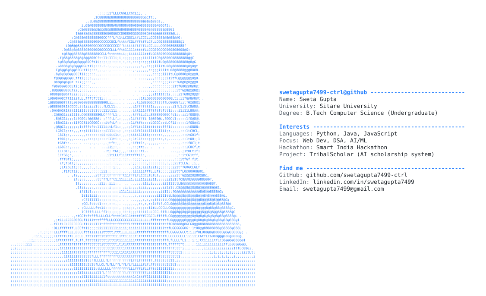

  <picture>
    <source media="(prefers-color-scheme: dark)" srcset="profile_card_dark.svg">
    
  </picture>

<h4 align="center"><samp>"Always curious, always learning, and always building."</samp></h4>

   

<ul>
<li>🎓 <samp><b>Computer Science Undergraduate @ Sitare University</b></samp></li>
<li>💻 <samp>Passionate about programming, problem-solving, and turning ideas into practical solutions through code.</samp></li>
<li>🌱 <samp>Currently focused on strengthening programming fundamentals, building meaningful projects, and exploring software development &amp; AI/ML research.</samp></li>
<li>⚡ <samp>Interests: Python, Java, Web Development, Data Structures &amp; Algorithms (DSA), and Artificial Intelligence &amp; Machine Learning.</samp></li>
</ul>

---

<h3><b><samp>Socials &amp; Links:</samp></b></h3>

---

<h3><b><samp>Featured Project &amp; Achievements:</samp></b></h3>
<ul>
<li>🏛️ <b>TribalScholar</b> — An AI-enabled scholarship and fellowship management system designed to streamline tracking, transparency, and distribution for students.</li>
</ul>

 

<h3><b><samp>Skills</samp></b></h3>

<h4><b><samp>Languages</samp></b></h4>

<h4><b><samp>Frontend &amp; Web</samp></b></h4>

<h4><b><samp>IDEs &amp; Version Control</samp></b></h4>

<h4><b><samp>Preferred AI (best on left to least on right)</samp></b></h4>

<h3><b><samp>Contribution Graph</samp></b></h3>

<picture>
  <source media="(prefers-color-scheme: dark)" srcset="https://raw.githubusercontent.com/swetagupta7499-ctrl/Sweta_DevPortfolio/output/github-contribution-grid-snake-dark.svg">
  <source media="(prefers-color-scheme: light)" srcset="https://raw.githubusercontent.com/swetagupta7499-ctrl/Sweta_DevPortfolio/output/github-contribution-grid-snake.svg">
  
</picture>
